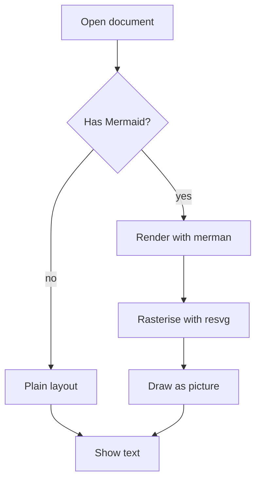
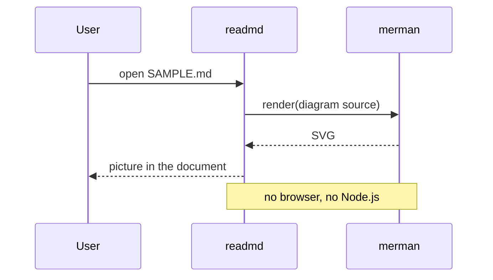
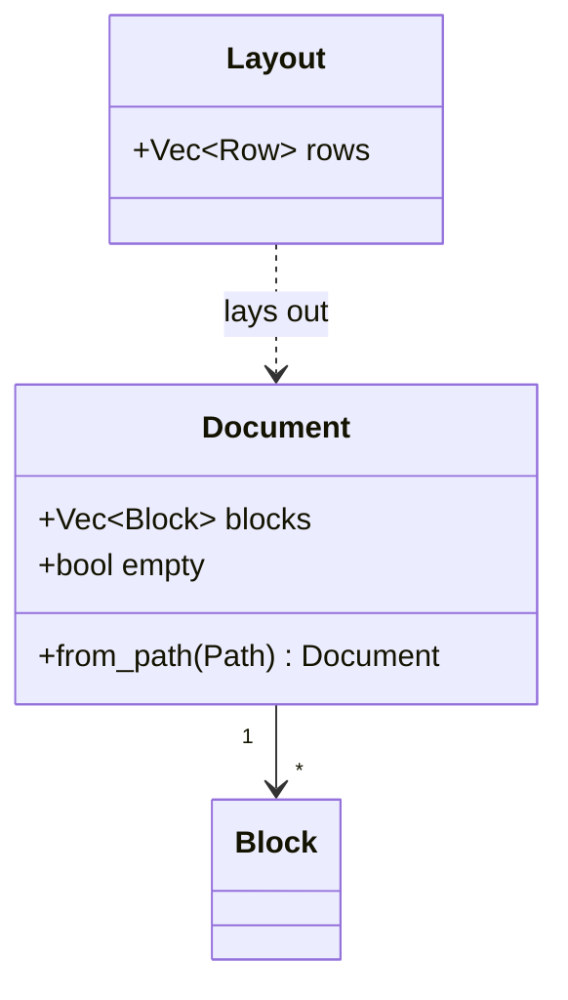
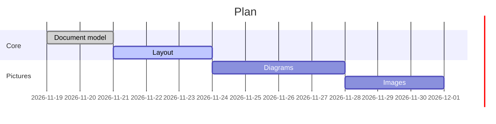
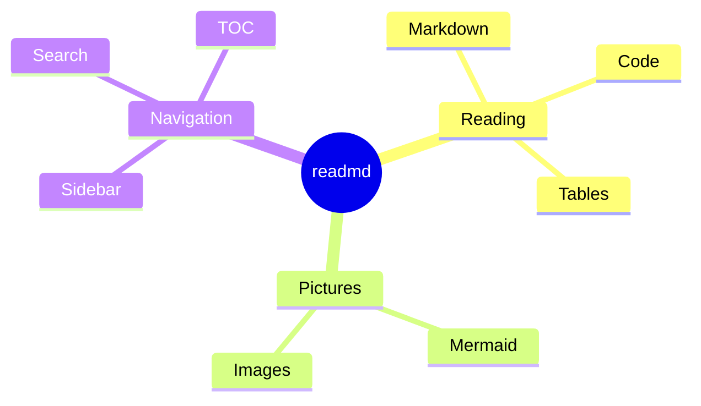
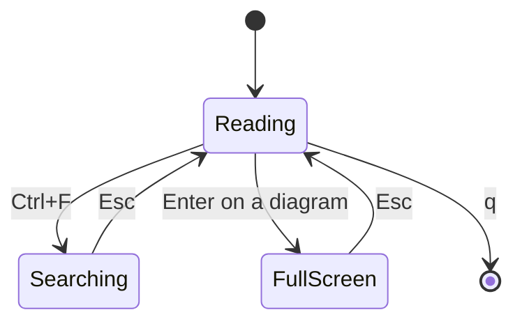
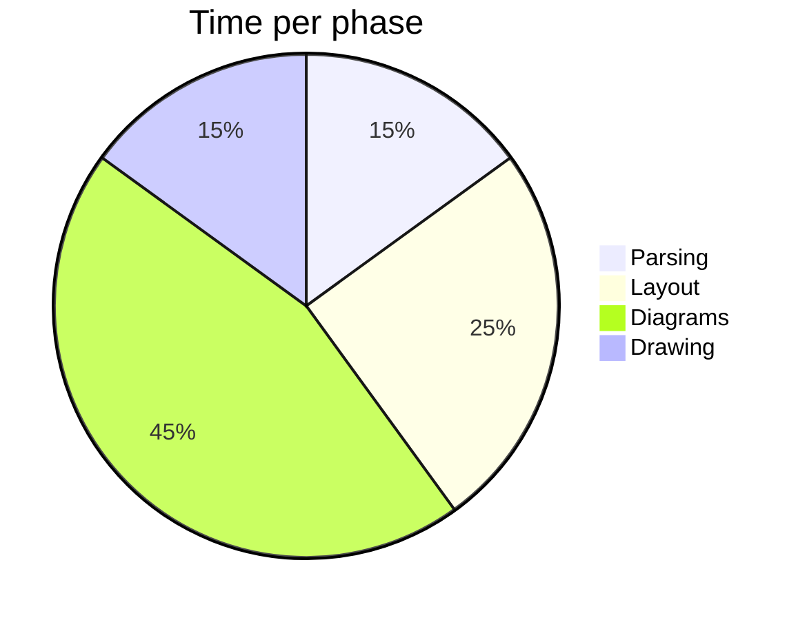
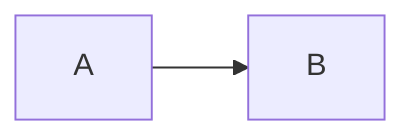

# readmd benchmark document

This file exercises **every element** that `readmd` must render. Open it with
`readmd SAMPLE.md` and compare each section with its description. It is the
reference for manual checks; the automated showcase lives in `fixtures/`.

[Jump to the table section](#tables) · [Jump to diagrams](#mermaid-diagrams)

## 1. Headings

# Heading level 1
## Heading level 2
### Heading level 3
#### Heading level 4
##### Heading level 5
###### Heading level 6

## 2. Inline text

Plain text, *emphasis*, _also emphasis_, **strong**, __also strong__,
***strong and emphasis together***, ~~strikethrough~~, and `inline code`.
Styles nest: **strong with *emphasis inside* and `code`**, and
*emphasis with ~~struck text~~*.

A hard break follows this line  
and this line starts after it. A soft break sits between
these two source lines.

A very long paragraph must wrap at word boundaries inside the pane, whatever
its width: Lorem ipsum dolor sit amet, consectetur adipiscing elit, sed do
eiusmod tempor incididunt ut labore et dolore magna aliqua. Ut enim ad minim
veniam, quis nostrud exercitation ullamco laboris nisi ut aliquip ex ea
commodo consequat. Supercalifragilisticexpialidocious-and-an-unbreakable-word-that-is-longer-than-any-reasonable-pane-width-should-be-broken-by-character.

Wide characters count two columns: 日本語のテキスト、中文文本、한국어 텍스트,
and emoji such as 🚀 ✅ ⚠️ keep the layout aligned. Accents: àèéìòù ÀÈÉÌÒÙ ñ ü ß.

## 3. Links

- External: [Monaspace fonts](https://github.com/githubnext/monaspace) opens in the browser.
- Mail: [write to someone](mailto:someone@example.com).
- Anchor: [back to the top](#readmd-benchmark-document).
- Anchor to a duplicate heading: [second "Notes"](#notes-1).
- Missing anchor: [nowhere](#does-not-exist) shows "Anchor not found".
- Local file: [another document](./fixtures/other.md) shows "Local file links are not supported".
- A link with **styled _text_** and `code`: [**bold** link with `code`](https://example.com).
- A long link that wraps over several rows: [this link text is deliberately long so that it needs to wrap across more than one row of the pane](https://example.com/long).

## 4. Lists

### Unordered, nested

- First item
- Second item with a long text that wraps onto the next row and must align with the item text, not with the bullet
  - Nested level two
    - Nested level three
      - Nested level four
  - Back to level two
- Third item

### Ordered

1. One
2. Two
   1. Two point one
   2. Two point two
3. Three with a long text that wraps onto the next row and must hang under the text, not under the number

A list that starts at ten:

10. Starts at ten
11. Eleven
12. Twelve

### Mixed

1. Ordered parent
   - Bullet child
   - Another bullet child
     1. Ordered grandchild
2. Second parent

### Task list

- [x] Done task
- [ ] Open task
- [x] Done task with **bold** and a [link](https://example.com)
  - [ ] Nested open task
  - [x] Nested done task

### Loose list (items separated by blank lines)

- Loose item one

- Loose item two with a second paragraph:

  The continuation paragraph aligns with the item text.

- Loose item three

## 5. Block quotes

> A simple quote with *emphasis* and a [link](https://example.com).
>
> A second paragraph in the same quote.
>
> > A nested quote, level two.
> >
> > > Level three.
>
> - A list inside a quote
> - With two items

## 6. Code blocks

Rust:

```rust
use std::collections::HashMap;

/// Counts words, ignoring case.
fn count_words(text: &str) -> HashMap<String, usize> {
    let mut counts = HashMap::new();
    for word in text.split_whitespace() {
        *counts.entry(word.to_lowercase()).or_insert(0) += 1;
    }
    counts
}
```

Python:

```python
def fibonacci(n: int) -> list[int]:
    a, b = 0, 1
    out = []
    while a < n:
        out.append(a)
        a, b = b, a + b
    return out
```

JSON, shell, YAML and an unknown language:

```json
{ "name": "readmd", "version": "0.1.0", "features": ["mermaid", "images"] }
```

```bash
cargo install --path . && readmd SAMPLE.md --protocol halfblocks
```

```yaml
theme:
  background: "#1a1b26"
  opaque: true
```

```unknownlang
plain text, no highlighting
```

A code block without a language:

```
no language tag here
```

A code line wider than the pane is truncated with an ellipsis, not wrapped:

```text
0123456789 0123456789 0123456789 0123456789 0123456789 0123456789 0123456789 0123456789 0123456789 0123456789 END
```

Indented code block:

    indented four spaces
    second line

## 7. Tables

### Alignment

| Left aligned | Centered | Right aligned |
| :----------- | :------: | ------------: |
| alpha        |   beta   |         gamma |
| 1            |    2     |             3 |
| **bold**     |  *ital*  |        `code` |

### Wider than the pane

| Name | Description | Notes | Status |
| ---- | ----------- | ----- | ------ |
| Column shrinking | When the table is wider than the pane the columns shrink proportionally and the cell text wraps inside the cell | Rows grow to the tallest cell | ✅ |
| Wide characters | 日本語 中文 한국어 | Two columns per character | ✅ |
| Inline styles | **bold**, *italic*, `code`, [link](https://example.com) | Styles survive wrapping | ✅ |

### Many columns

| A | B | C | D | E | F | G | H | I | J |
| - | - | - | - | - | - | - | - | - | - |
| 1 | 2 | 3 | 4 | 5 | 6 | 7 | 8 | 9 | 10 |

## 8. Horizontal rules

Above the rule.

---

Between rules.

***

Below the rules.

## 9. Footnotes

Footnotes are numbered by first use[^first], and a second one follows[^second].
A reference to the first one again[^first] reuses its number.

[^first]: The first footnote text, listed at the end of the document under a rule.
[^second]: The second footnote, with **styled** text and a [link](https://example.com).

## 10. Raw HTML

<div align="center">Raw HTML blocks are shown as dimmed raw text.</div>

Inline HTML such as <kbd>Ctrl</kbd> + <kbd>F</kbd> is also shown as dimmed raw text.

<!-- an HTML comment -->

## 11. Images

### Local images

A PNG (a gradient, 240×90 px, never enlarged beyond its natural size):


An SVG (rasterised):


An image inside a paragraph,  in the middle of a sentence.

### Missing and remote images

A missing file shows a dimmed placeholder with its alt text:


A remote image is never downloaded; it shows the URL as a placeholder:


## Mermaid diagrams

### Flowchart



### Sequence diagram



### Class diagram



### Gantt chart



### Mindmap



### State diagram



### Pie chart



### A diagram with a syntax error

The block below is invalid on purpose: it must show the error message and the
source in a red frame, without breaking the rest of the document.

```mermaid
flowchart TD
    A[Start --> B{
    B ---> ??? C
```

### Capitalised language tag

```Mermaid
graph LR
    X --> Y --> Z
```

### A small diagram stays small



### Diagram nested in a list

- A list item that contains a diagram:

  ```mermaid
  graph TD
      L1 --> L2
  ```

## Notes

A heading named "Notes" appears twice, to check duplicate anchors.

## Notes

The second "Notes" heading gets the anchor `#notes-1`.

## 12. Edge cases

An empty emphasis ** ** and an escaped \*asterisk\*, plus a backslash \\ and
HTML entities: &amp; &lt; &gt; &copy;.

A line with trailing spaces and a URL autolink: <https://example.com/autolink>.

A setext heading, underlined with dashes (renders as a level 2 heading)
-----------------------------------------------------------------------

The end of the benchmark. If you can read this line, the whole document has
been laid out and scrolled to the bottom.
